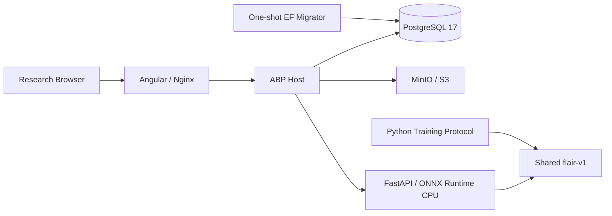

# ADR 0001：可构建科研工程骨架

状态：接受。日期：2026-11-06。

仅供科研与教学演示，非医疗器械，不用于临床诊断。

## 背景

初始仓库只有 Git 元数据与项目约定，没有业务代码、版本锁或独立审计报告。本阶段目标是验证各技术栈能够构建、独立诊断并通过基础契约测试，不实现尚无数据与权重支撑的研究结论。

## 决策

- 采用实际查询并编译验证的 .NET 10 / ABP 10.7.1，保持 Domain.Shared、Domain、Application.Contracts、Application、EF Core、HttpApi、Host 的职责边界，不把业务逻辑放进控制器。
- Identity、OpenIddict、Permission Management、Setting Management 和审计表通过正式 EF PostgreSQL 迁移管理；迁移容器必须先成功，Host 才启动。不在 Host 自动 `EnsureCreated`，不创建默认管理员或明文客户端密钥。
- 只使用单租户模块化单体；缓存是进程内默认实现，没有使用 Redis，因此不启动 Redis。开发临时签名密钥不适合多副本或长期令牌，生产要求证书和独立密钥管理。
- 开发存储默认本地文件；`IObjectStorage` 另有 MinIO/S3 实现。对象键由系统生成、内容计算 SHA-256、限定大小、校验读取/删除键，MRI 二进制不进入 PostgreSQL。
- MinIO 历史 Docker Hub 标签不可查询，Quay 匿名 manifest 校验也失败；不用猜测可拉取性。改从官方 `RELEASE.2025-10-15T17-29-55Z` 的固定提交 `9e49d5e7a648f00e26f2246f4dc28e6b07f8c84a` 构建，并检查 Git HEAD、保持 `go.sum` 只读、保留 AGPL 许可证。Go 1.24.9 镜像满足实际 `go.mod` 的 Go 1.24 / toolchain 1.24.8 要求。实际镜像构建仍需 Docker 环境验证。
- Angular 版本遵循 ABP 官方生成工具的 Angular 22 依赖，再升级到已发布的安全修补线。使用 Standalone、signals、中文资源和 Lucide 图标，不加入未实现业务页面。
- 前端代理由正在运行的真实 ABP API 定义生成。官方输出中的 `any` 用 TypeScript AST 机械收紧为 `unknown`；应用组件没有手写重复 HTTP 调用。骨架跳过初始 ABP 配置和登录初始化，并显式提供中文 locale，管理 API 的权限仍在后端执行。
- FastAPI 使用 CPU ONNX Runtime，启动核对 SHA-256，失败保留服务与诊断。测试注入的合成预测器/合成 ONNX 只用于契约验证，不能注册为正式实验结果。
- `flair-v1` 预处理与标签映射由训练和推理共享。患者级划分、配置校验和指标函数可运行；训练循环与患者级三维评估不在本阶段范围。
- 区分 `/health` 与 `/ready`。无权重时推理 `/health` 返回 200、`/ready` 返回 503；Compose 用存活检查启动基础栈，不要求虚构模型。后端就绪检查的是数据库、对象存储与推理进程连接，不等同于模型可执行。
- JSON 日志与已校验 `X-Correlation-Id` 贯穿后端与 Python。错误响应不泄露连接信息、文件路径或堆栈；日志不记录影像、令牌或身份信息。
- 使用单一环境模板，本地随机密钥只写入被忽略的 `.env`；容器显式选择所需变量，Python 服务不接收数据库或存储管理员凭据。
- 固定直接依赖与 NuGet/npm/uv 锁文件。NuGet 加密包与 Angular 工具链的已知告警通过定向修补处理，未关闭审计或使用强制 peer 安装；这些约束需在以后升级时重新评估。

## 部署结构

## 后果与限制

容器只绑定本机，应用镜像为非 root，真实 `.env`、MRI、权重与证书不进入构建上下文。当前 Compose 使用 HTTP 和开发签名密钥，不是公网生产配置。生产还需 TLS、有限权限对象存储账号、永久签名/加密证书、备份、速率策略和经扫描固定 digest 的镜像。

本机没有 Docker，不能将 YAML 解析与静态检查当作镜像构建或 PostgreSQL/MinIO 集成测试成功。CI 已设置真实构建、迁移和健康冒烟门禁，首次远程执行结果仍须核验。所有真实训练、GPU 性能、患者级实验指标和配对检验均未执行。