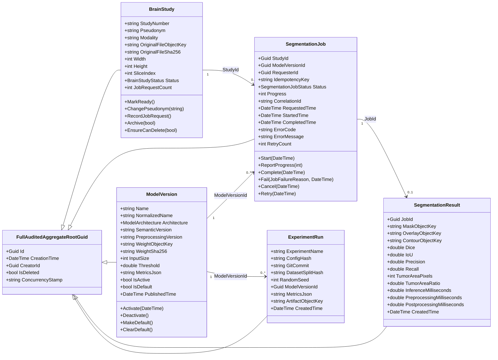
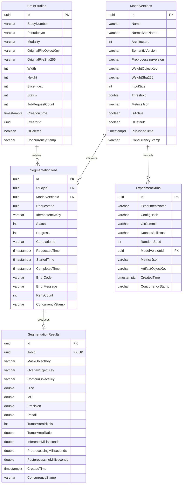
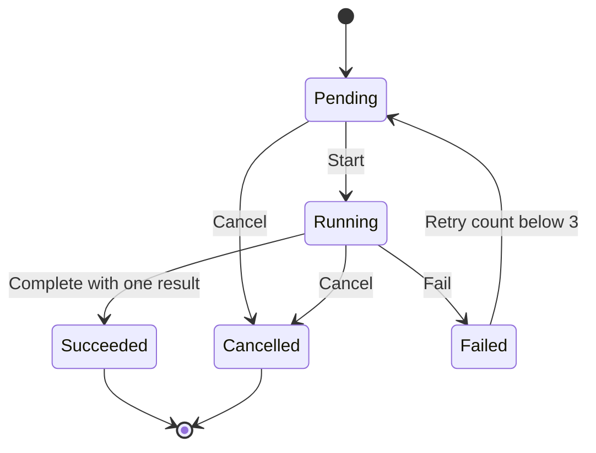

# 科研领域与 API

仅供科研与教学演示，非医疗器械，不用于临床诊断。本文中的指标字段不是实际 BraTS 实验结论。

## 分层与约束

Domain.Shared 放枚举、错误码和本地化资源；Domain 放五个聚合及仓储接口；Application.Contracts 放 DTO、服务接口及权限定义；Application 编排授权、存储、事务及映射；EntityFrameworkCore 实现仓储、约束和迁移；HttpApi.Host 沿用 ABP 自动控制器，不在控制器实现业务规则。

所有实体继承 `FullAuditedAggregateRoot<Guid>`，共用 Id、CreationTime、CreatorId、LastModificationTime、LastModifierId、IsDeleted、DeletionTime、DeleterId、ConcurrencyStamp 和 ExtraProperties。业务时间以 UTC 存储。结果和实验记录是不可变记录，没有任意更新或物理删除 API。

## Mermaid 类图

图中的 StartedTime、CompletedTime、PublishedTime、ErrorCode/ErrorMessage 和四个结果指标允许为空。没有真值标签时，结果指标保持 null，不用 0 或 1 冒充实验结果。

## Mermaid 数据库 ER 图

为简洁起见，ER 图省略部分继承审计列；五张表都包含完整审计与软删列。所有外键使用 RESTRICT，不进行物理级联。复合及条件唯一性以实际索引表为准，不把复合键误画成单列唯一。

| 唯一索引 | 键 | 范围 |
| --- | --- | --- |
| UX_BrainStudies_Number | StudyNumber | 仅 IsDeleted=false，编号归一化为大写 |
| UX_BrainStudies_FileSlice | OriginalFileSha256, SliceIndex | 仅 IsDeleted=false；同体不同切片可单独登记 |
| UX_ModelVersions_Identity | Architecture, NormalizedName, SemanticVersion | 仅 IsDeleted=false |
| UX_ModelVersions_Default | IsDefault | 仅 IsDefault=true 且 IsDeleted=false，全局最多一个默认模型 |
| UX_SegmentationJobs_Idempotency | RequesterId, IdempotencyKey | 保留历史身份，不因软删而释放 |
| UX_SegmentationResults_Job | JobId | 一个任务最多一个结果 |
| UX_ExperimentRuns_Reproducibility | ExperimentName, ConfigHash, DatasetSplitHash, GitCommit, RandomSeed, ModelVersionId | 同一可复现身份不能重复登记 |

另建 Study 状态/时间、Job 状态/请求时间、StudyId/状态、模型启用/架构、结果及实验时间索引。检查约束限定图像尺寸、进度、重试数、输入尺寸、阈值、默认模型启用状态、面积、指标及耗时。

## 状态机

进度仅在 Running 下可递增到 99，只有成功完成能设为 100。失败原因来自受限枚举，不接受任意堆栈/内部路径作为 ErrorMessage。重试保持同一 Job，递增 RetryCount，清空上一轮错误、计时及进度。Failed 达到上限后不再重试。

Study 是 Uploaded → Ready → Archived；只有 Ready 且未删除的影像可接受任务。模型登记初始未启用；启用前验证对象 SHA-256，设为默认必须先启用，停用同时取消默认标记。停用不删除权重，也不阻止此前已接收任务完成；新建和重试任务要求启用模型。注册/启用仅表示业务登记状态，不替代 FastAPI 的模型加载就绪检查。

## API 与权限

沿用现有 ABP 自动控制器和统一错误封装。创建与命令返回 200，删除成功返回 204；未认证 401、无权限 403、未找到 404、并发与状态/唯一性冲突 409、无效输入 400、超限 413。不要另加绕过 Application Service 的写接口。

| 资源前缀 `/api/app/` | 操作 | 父级读权限 | 写入附加权限 |
| --- | --- | --- | --- |
| brain-study | 列表/详情、upload、PUT、archive、DELETE | BrainSeg.BrainStudies | Create / Update / Delete |
| segmentation-job | 列表/详情、创建、start、report-progress、complete、fail、cancel、retry | BrainSeg.SegmentationJobs | Create / Execute / Cancel / Retry |
| model-version | 列表/详情、创建、set-state | BrainSeg.ModelVersions | Create / Manage |
| segmentation-result | 列表/详情，只读 | BrainSeg.SegmentationResults | 无，结果只能通过 Job.complete 写入 |
| experiment-run | 列表/详情、创建不可变记录 | BrainSeg.ExperimentRuns | Create |

例如 Job.start 必须同时具有 `BrainSeg.SegmentationJobs` 与 `BrainSeg.SegmentationJobs.Execute`。任务创建必须有用户 ID，服务主体不能靠随机请求人绕过幂等分区。当前是权限控制的单租户科研工作区，不提供患者姓名、证件号或医院编号字段。

写命令必须提交详情接口返回的 ConcurrencyStamp。PUT 和 POST 将其放入 JSON；Study DELETE 使用查询参数 `?concurrencyStamp=...`。服务器先拒绝已过期的客户端戳，再由 EF 的并发令牌拒绝“两个调用同时读到旧版本”的竞争。

列表参数为 skipCount、maxResultCount（1–100）、filter、sorting（单字段及 asc/desc）。默认 creationTime desc，附加 Id 稳定排序。排序白名单：Study 的 creationTime/studyNumber/pseudonym/status；Job 的 creationTime/requestedTime/status/progress；模型的 creationTime/name/semanticVersion/architecture；结果的 creationTime/createdTime/inferenceMilliseconds/tumorAreaPixels；实验的 creationTime/createdTime/experimentName/randomSeed。语义版本字符串排序为字典序，不冒充版本优先级比较。

各列表另支持状态、StudyId、ModelVersionId、架构、启用、JobId 或随机种子的相应筛选。结果 filter 匹配 Job CorrelationId。禁止传任意动态 LINQ 表达式。

## 文件、事务与保留策略

上传为 multipart：StudyNumber、Pseudonym、SliceIndex、File。只收 NIfTI-1 .nii/.nii.gz，原始文件上限 64 MiB、解压上限 128 MiB，检查头、字节序、三维尺寸、切片边界、真实数值类型和完整载荷。服务端从头读取尺寸，文件名不用于对象路径；原始字节计算 SHA-256 后交给 IObjectStorage，数据库只存键、哈希和元数据。完整数值范围、仿射变换及模型输入验证仍由共享 Python 推理实现负责，不在 ABP 中重写模型算法。

上传发生数据库回滚时清理此次新对象；清理失败只记录稳定告警和对象键，后续需审计处理。File 属性标记 DisableAuditing，不把文件名或原始文件内容放进审计参数；仍记录上传操作及操作者。

创建或重试任务会更新 Study.JobRequestCount，推进同一 Study 的并发版本。因此“检查无活动任务后软删”和“并发调度”不能同时用旧版本成功。JobRequestCount 是已接收的调度次数，包含重试，不是切片数或研究指标。

Study 删除策略是**软删除、保留关联科研记录和文件**。Pending/Running Job 会阻断归档和删除；终态 Job、Result 与模型/实验版本均不级联清除，仍要求相应权限才能查阅。旧 Study 不出现在常规 Study 查询，其他保留记录可按 ID 审计追溯。当前不提供自动物理清理或恢复 API；未来清理必须单独定义保留期、审计和授权，不能复用本删除接口。

Job 完成的结果与成功状态处于同一 ABP 事务；缺失对象、非法转换、并发失败或唯一冲突均不产生半条结果。模型默认切换同样处于事务，数据库部分唯一索引是最后防线。PostgreSQL 23505 按已知约束转换为本地化稳定业务错误，不把 SQL 错误暴露给客户端。

结果掩膜为预处理后的 256×256 切片，面积比例由像素数计算。这里的可选 Dice/IoU 是切片级记录，不能替代论文要求的患者级三维指标、三种子统计与配对检验。

## 迁移与验证

迁移文件：[AddResearchDomain](../../apps/backend/src/BrainSeg.EntityFrameworkCore/Migrations/20261106041834_AddResearchDomain.cs)。运行根 README 的 `--migrate` 命令应用全部迁移，不使用 EnsureCreated 替代生产迁移。

本地关系测试使用真实 SQLite，测试认证和内存审计只存在于测试工程；生产授权、审计与 PostgreSQL provider 未被替换。专用 PostgreSQL 测试读取 `BRAINSEG_TEST_POSTGRES`，要求可创建临时数据库的隔离测试实例；每次仅创建/删除自身随机命名的 `brainseg_test_<guid>` 数据库，不删除传入连接的业务数据库。未配置时显示 Skip，CI 后端 job 会提供仅绑定 loopback 的临时 PostgreSQL，trust 认证仅用于该一次性 CI 容器，不能复制到生产配置。

AutoMapper 14 的递归 DoS 告警通过固定 15.1.4 修补，ABP 配置创建器已适配新构造函数，未关闭 NuGet 审计。开发/测试未配置许可证时的提示不屏蔽；生产许可通过 AutoMapper__LicenseKey 由部署环境提供。