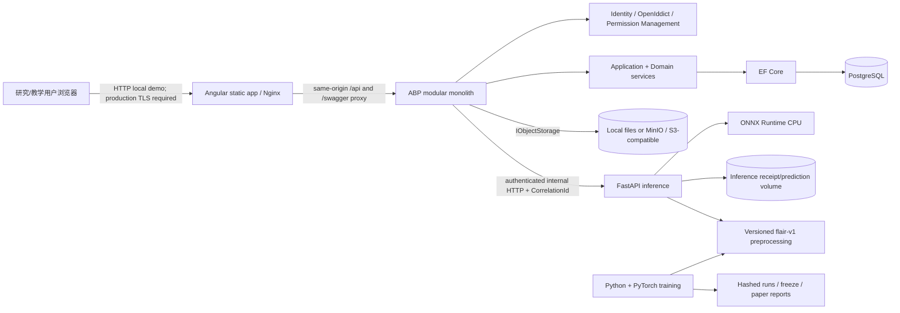
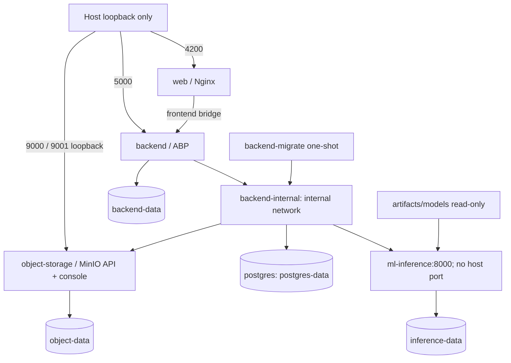
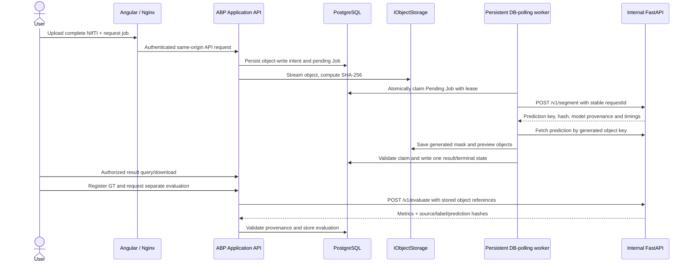

# 系统与部署图

**免责声明：仅供本科毕业设计、科研与教学演示，非医疗器械，不用于临床诊断，不提供确诊、治疗或预后建议。**

部署图对应 [基础 Compose 配置](../compose.yaml)；`compose.dev.yaml` 只是宿主机调试 overlay。

## 系统架构

## Compose 网络与持久化部署

Compose `healthcheck` is process liveness; `/ready` performs service/model readiness checks. Without real valid weights, ML and ABP `/ready` return 503 even if Compose reports containers healthy.

## Upload-to-result sequence

## ER 图来源

正式 Mermaid ER 图（含五个聚合和对象写入意图）由[科研领域与 API 文档](api/research-domain.md)维护，以迁移和实体配置为准。本页不复制第二份 ER 源，避免两份图漂移。此链接不表示 PostgreSQL 容器已在本阶段启动或迁移。
